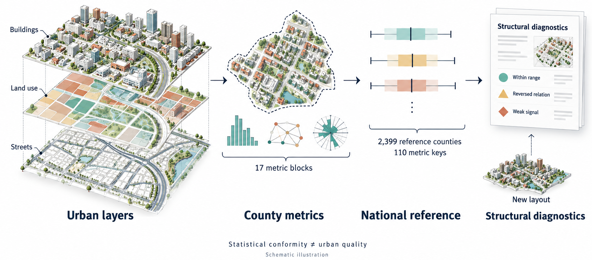
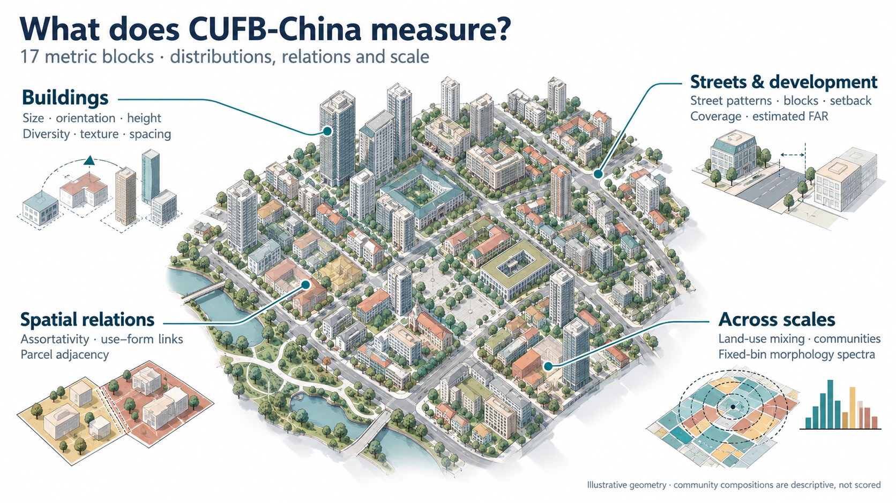
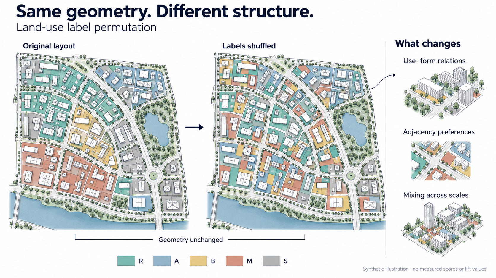

*Project overview. Geometries and percentile intervals are schematic. The reference describes observed Chinese county statistics; conformity does not measure urban quality.*

**A national reference for comparing the statistical structure of real and generated urban layouts.**

CUFB-China (**China Urban-Form Benchmark**) combines buildings, land-use parcels and streets into a shared county-level representation. It describes how urban form varies across China and provides an interpretable protocol for identifying where a new layout departs from that reference.

**23.47M county-assigned building footprints · 2,399 reference counties · 17 metric blocks · 110 reference metric keys**

- **Data descriptor:** *County-level urban form metrics and reference bounds for real and generated cities in China*, Scientific Data — **[TODO: final DOI and publication status]**.
- **Data record:** county tables, reference bounds, starter county, benchmark cases and validation outputs, Figshare — **[TODO: final DOI]**.
- **Software archive:** code release, Zenodo — **[TODO: final DOI]**.

## What is CUFB-China?

CUFB-China is a county-level urban-form dataset and a structural benchmark. It starts from CMAB building footprints with model-estimated height and construction era, EULUC-China 2.0 land-use parcels and OpenStreetMap streets, partitioned using CTAmap county boundaries.

The workflow covers **2,899 county-level units**. County metrics are released for the **2,585 units with mapped buildings**; the **2,399 counties with at least 1,000 mapped buildings** form the national reference. Here, “county” includes urban districts, county-level cities and other county-level administrative types.

Reference percentiles are computed **across counties, with one value per county**, so counties with more buildings do not dominate the bounds. The release includes national p5/p50/p95 statistics, relational direction statistics and province-level bootstrap intervals, together with reference bounds stratified by county type, building count and estimated construction era.

| If you want to… | Start with… |
| --- | --- |
| Compare counties or join urban-form measures to other datasets | `county_metrics.csv` and the six-digit administrative code `PAC` |
| Inspect land-use relationships or morphology distributions | `county_relations.csv` and `county_spectra.nc` |
| Diagnose a real or generated layout | The [starter example](#quick-start), then [scoring your own city](#scoring-your-own-city) |
| Rebuild the reference or adapt the workflow | [Full reproduction](#full-reproduction) |

This repository contains the **code**. The accompanying data record contains the released tables, references and reproducibility examples. Complete nationwide county input shapefiles are rebuilt from the upstream sources rather than redistributed here.

## What does it measure?

The 17 metric blocks describe building distributions, spatial relationships, land-use organisation, street and block geometry, development intensity and fixed-bin morphology spectra.



*Metric anatomy. Blocks are grouped here for readability, and the figure labels selected metrics; the table below lists all 17 blocks. These groups are not the scoring layers; the conformity protocol groups available checks into eleven layers. Community compositions and derived national archetypes are descriptive outputs and are not scored.*

| Metric blocks | What they describe |
| --- | --- |
| **1–6: Building population** | Footprint size distribution, orientation, size–height diversity, height Moran’s I, fractal texture and a solar-spacing proxy |
| **7–9: Building and parcel relations** | Building assortativity (L1), morphology by land use (L2) and parcel adjacency lift (L3) |
| **10–12: Land-use organisation** | Road enclosure by land use (L4), Louvain-community compositions (L5) and mixing entropy across 0.5–8 km radii (L6) |
| **13–16: Streets and development** | Street orientation and length, polygonised block sizes, a building–street setback proxy, parcel coverage and estimated FAR |
| **17: Morphology spectrum** | Fixed-bin distributions of area, height, compactness, rectangularity, elongation and orientation, plus deviation from the national reference |

An **adjacency lift** compares the observed share of a land-use pair with its expected share under the specified null model: 1 means no preference, values above 1 indicate attraction and values below 1 indicate repulsion. The parcel-adjacency layer uses a degree-weighted null.

## Why a structural benchmark?

A layout can preserve its geometry while changing its statistical structure. For example, permuting parcel land-use labels leaves building footprints and street geometry untouched, but disrupts, in expectation, the association between land use and building form, parcel adjacency preferences and spatial mixing.



*Conceptual example, not a measured county result. The same geometries appear in both maps; only land-use labels change. R/A/B/M/S denote residential, public administration and services, commercial and business, industrial, and transport uses. No experimental scores or lift values are plotted.*

CUFB-China complements visual inspection and image-based evaluation by asking: **which measured structures agree with the selected real-county reference, and where do they depart?**

The controlled benchmark uses **50 independent test counties**, excluded from the reference used for that test, and seven perturbations: uniform buildings, footprint scaling, land-use shuffle, height shuffle, position jitter, rotation and street-class shuffle. The test reference contains **2,349 counties**; the full released national reference contains **2,399**. Protocol weights and thresholds are not fitted to the perturbation results.

## Installation

From the repository root:

```bash
conda env create -f environment.yml
conda activate cufb
```

The pinned environment uses Python 3.12 with geopandas 1.1, shapely 2.1, pyogrio, scipy, scikit-learn, networkx and matplotlib. `validate.py crosscheck` additionally requires momepy and osmnx. Generator converters have their own dependencies; see their docstrings.

## Quick start

Run the complete analyse–score workflow on a small real county without downloading the nationwide inputs.

1. Download `02_reference_bounds.zip` and `05_starter.zip` from the accompanying Figshare data record.
2. Extract them so the reference is at `data/02_reference_bounds/` and the starter county is at `data/05_starter/<county-folder>/`.
3. Run from the repository root:

```bash
bash examples/run_starter.sh
```

The starter is **Wuzhishan, Hainan**, with **1,987 mapped buildings**. The script analyses its layers, scores the results against the national reference and checks that the metric values reproduce the released `result.json`. The original workflow is designed to take about one minute on a standard laptop; runtime depends on the environment.

To run the two main steps yourself, replace `<county-folder>` with the extracted folder name:

```bash
STARTER_DIR="data/05_starter/<county-folder>"

python code/urbanBenchmark/benchmark.py analyze \
  --input "$STARTER_DIR" \
  --out starter_out

python code/urbanBenchmark/score.py \
  --city starter_out \
  --ref data/02_reference_bounds
```

Analysis writes `result.json` and, when buildings are available, `spectrum.json`. Scoring reports overall conformity, layer conformities, the number of checks and failed checks. Wuzhishan belongs to the national reference, so this starter demonstrates reproducibility and **in-sample scoring**; the independent benchmark uses the separate test-excluded reference.

## Scoring your own city

### Prepare the available layers

Place the layers in one city folder. Keep the shapefile companion files, including CRS information, alongside each `.shp` file.

| File | Geometry / fields | Meaning |
| --- | --- | --- |
| `building.shp` | Footprint polygons; `Height` | Building height in metres |
| `landuse.shp` | Parcel polygons; `Level1_cn` | The five Chinese EULUC-China Level-1 labels expected by `benchmark.USES` |
| `roads.shp` | Street lines; `fclass` | OpenStreetMap-style street classes |
| `_meta.json` (optional) | Provenance and scale metadata | Source, conversion assumptions and spatial scale |

Layers that a generator does not produce can be omitted. The score is computed from the checks supported by the available layers, and the check count is reported.

**Land-use labels:** analysis keys in `result.json` and the national/stratified bounds use the EULUC-China Level-1 labels produced by the analysis. Released `county_metrics.csv` and `county_relations.csv` use the GB 50137-2011 codes **R/A/B/M/S** (residential, public administration and services, commercial and business, industrial, and transport) instead. Use `data_dictionary.csv` to map the two representations; do not assume the letter codes can be placed directly into `Level1_cn`. `gen_import.py drlplan` illustrates mapping another class scheme to the expected input labels.

`gen_import.py` provides converters for josauder/procedural_city_generation, ProbableTrain/MapGenerator, CityDreamer layouts and DRL-urban-planning plans.

### Analyse and score

Set `CITY_INPUT` to your city folder:

```bash
CITY_INPUT="path/to/my_city"

python code/urbanBenchmark/benchmark.py analyze \
  --input "$CITY_INPUT" \
  --out my_city_out

python code/urbanBenchmark/score.py \
  --city my_city_out \
  --ref data/02_reference_bounds
```

The default is **protocol v2**. Protocol v1 remains available through `--protocol v1` for comparison.

### Interpret and report the result

The protocol uses interval checks, direction-and-magnitude checks, and curve/spectrum checks. Within each scoring layer, conformity is the fraction of checks passed; overall conformity is the weighted mean across layers with at least one check.

Failed checks retain the metric value, reference bound or required direction, and failure type: `low`, `high`, `reversed`, `no-signal`, `curve-off` or `atypical`. Use these diagnostics to understand the departure alongside the overall score.

Whenever reporting a score, include:

- The **reference and protocol version**, including any selected stratum.
- The **spatial scale and its source**.
- The **available layers and number of checks**.
- The **layer conformities and failed checks**.

The full national reference is the default. Stratified bounds are available when the target explicitly represents a county type, building-count group or construction-era subset. Era-specific fractal dimension and intensity must be compared with the corresponding era reference.

Use the generator’s parameters or published resolution to set metre scale. If scale is uncertain, report a justified sweep. Cases with different available layers, check counts or spatial support are not directly comparable as a ranking of generator quality.

## Data products

The accompanying data record provides:

| Product group | Principal files | Use |
| --- | --- | --- |
| County tables | `county_metrics.csv`, `county_relations.csv`, `county_spectra.nc` | County descriptors, relations and fixed-bin distributions |
| Reference products | `national_bounds.csv`, bounds by type/size/era, `national_reference_spectrum.json`, `spectrum_deviation.csv` | National and stratified reference statistics |
| Community products | `community_vectors.csv`, `national_archetypes.json`, `archetype_by_province.csv` | Descriptive land-use community compositions |
| Benchmark cases | `test_counties.txt`, `test_reference/`, `benchmark_results.csv`, `benchmark_violations.csv`, `generated_cases/` | Independent controlled tests and external demonstrations |
| Starter county | `05_starter/{county}/` | Input layers and expected analysis outputs |
| Technical validation | Validation outputs in the data record | Cross-implementation, sensitivity, subsampling and source-error experiments |
| Release metadata | `data_dictionary.csv`, `manifest.json`, `LICENSE`, `CITATION.cff` | Definitions, provenance, checksums, terms and citation |

## Scope and interpretation

**Conformity measures statistical agreement with a specified Chinese county reference.** It does not measure visual quality, planning performance, architectural merit or suitability for a generator’s intended purpose.

County boundaries include rural territory, while CMAB maps natural cities rather than all dispersed rural settlements. The inputs are multi-temporal: building imagery is mostly from 2022–2024, land use is for 2022, streets are a 2024 snapshot, boundaries are for 2020, and construction era is derived from the 1985–2018 GAIA series. Building heights and eras are model estimates, and land-use metrics inherit source-label uncertainty.

Several quantities are proxies: FAR is estimated from height using a fixed 3 m storey assumption, setback is measured from building representative points rather than façades, and the solar-spacing proxy is not a code-compliance test. Retain the released definitions and parameters when comparing with the reference.

Chinese county percentile ranges should not be treated as universal acceptance thresholds for cities in other countries. Rebuilding a reference elsewhere requires harmonised spatial units, land-use categories and input-data quality.

## Repository layout

```text
code/urbanBenchmark/
  split_county.py      split nationwide layers into county folders
  cmab_ingest.py       place CMAB province archives in the input tree
  euluc2_ingest.py     split EULUC-China 2.0 (gdb) into county landuse.shp
  benchmark.py        analyze / runall / aggregate metric blocks and bounds
  spectrum.py         fixed-bin spectra, national reference and deviations
  score.py            conformity v2/v1, batch scoring and paired-bootstrap AUC
  export.py           county tables, spectra, benchmark results and manifest
  archetypes.py       descriptive community vectors and national archetypes
  release_tables.py   English headers and R/A/B/M/S codes in release tables
  perturb.py          controlled benchmark perturbations
  validate.py         implementation, sensitivity, subsampling and noise tests
  gen_import.py       convert third-party outputs to the county input format
  gen_citydreamer.py  run the CityDreamer layout generator
  gen_mapgenerator.py run ProbableTrain/MapGenerator headlessly
  fig_paper.py        manuscript figures
  fig_generated.py    generated-city figures
  run_era.sh          construction-era runs
  run_gate1.sh        independent controlled benchmark
  run_validation.sh  technical validation runs
  run_reaggregate.sh reaggregation batch runs
examples/
  run_starter.sh      minimal end-to-end starter example
assets/
  overview.png        project overview
  metric-anatomy.png  metric anatomy
  structural-shuffle.png  conceptual land-use permutation example
environment.yml       pinned software environment
```

## Full reproduction

The following sequence preserves the workflow used for the manuscript. It requires the nationwide upstream datasets; the starter example does not.

### Upstream inputs

Obtain the source datasets under their respective terms and arrange them as follows:

| Expected path | Input |
| --- | --- |
| `dataset/input/buildings/{province}/*.shp` | CMAB v7 per-city shapefiles; [Figshare record](https://doi.org/10.6084/m9.figshare.27992417); ingest with `cmab_ingest.py` |
| `dataset/input/landuse/` | EULUC-China 2.0; [Zenodo record](https://doi.org/10.5281/zenodo.16794007); `euluc2_ingest.py split` writes county `landuse.shp` directly |
| `dataset/input/roads/gis_osm_roads_free_1.shp` | Geofabrik China extract of OpenStreetMap, snapshot 2024-05-29 |
| `dataset/input/boundary/` | CTAmap county-level polygons, 2020 layer, with original filename and province, prefecture, `NAME`, type and `PAC` fields |

The expected boundary filename is set in `split_county.py` and `fig_paper.py`. See the data descriptor for source details and licences.

### Build county metrics and reference products

Run from the repository root. The nationwide split takes hours and is resumable; batch county analysis is also resumable.

```bash
B=code/urbanBenchmark

python $B/split_county.py --provinces all --layers buildings landuse roads --root dataset/input --out dataset/input_county
python $B/benchmark.py runall --root dataset/input_county --out dataset/output_county

python $B/benchmark.py aggregate --root dataset/output_county --min-cities 20 --min-n 1000 --bootstrap 200
python $B/benchmark.py aggregate --root dataset/output_county --min-cities 20 --min-n 1000 --strata type
python $B/benchmark.py aggregate --root dataset/output_county --min-cities 20 --min-n 1000 --strata size
bash $B/run_era.sh

python $B/spectrum.py reference --root dataset/output_county --min-n 1000
python $B/export.py --root dataset/output_county --input-root dataset/input_county --en
python $B/export.py --root dataset/output_county --relations
python $B/export.py --root dataset/output_county --spectra
python $B/archetypes.py --root dataset/output_county
```

### Reproduce benchmark tests, validation and figures

```bash
B=code/urbanBenchmark

bash $B/run_gate1.sh 50 0
bash $B/run_validation.sh 50 20 20 20

python $B/validate.py heightnoise --root dataset/input_county --counties dataset/ref_holdout/holdout.txt --n 20 --out dataset/validation
python $B/validate.py labelnoise --root dataset/input_county --counties dataset/ref_holdout/holdout.txt --n 20 --out dataset/validation

python $B/export.py --root dataset/output_county --results
python $B/fig_paper.py --out dataset/figures
```

Analysis parameters are collected in `PARAMS` in `benchmark.py`. Override them with `--param key=value`; non-default values are recorded in `result.json["_params"]`. Random steps use fixed seeds. Comparisons with the released bounds should use the same metric definitions and parameters.

## Citation and licence

Please cite the data descriptor, data record and software archive using `CITATION.cff`, together with the upstream sources:

- **CMAB:** Zhang, Zhao & Long (2025), *Scientific Data* 12, 430.
- **EULUC-China 2.0:** Li et al. (2025), *Science Bulletin* 70, 3029–3041.
- **OpenStreetMap:** OpenStreetMap contributors.
- **CTAmap:** Rui, Zhang & Chen (2025), *Proc. SPIE* 13565.

Code is released under the **MIT licence** (`LICENSE`). Derived tables in the data record use **CC BY 4.0**; redistributed OpenStreetMap geometry remains under **ODbL 1.0**, and other redistributed geometry retains the applicable upstream terms. See the data record’s `LICENSE` for details.
